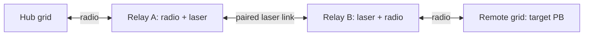

# Forth Wall Attenna development plan

Updated October 18, 2026. This records the agreed scope, implementation order,
research findings, and acceptance checks. The first usable prototype is implemented
and has passed the radio-relay deployment demo in the local game.

## Agreed scope

- Start with local single-player on CachyOS/Proton.
- Include Pulsar installation and setup; Pulsar 2.4.3 Legacy is now installed.
- First demo: discover a reachable Programmable Block, upload a script, inspect
  compilation results, and explicitly run it.
- Automatically expose reachable PBs owned by the local player. No per-block
  Custom Data flag or helper script is required for discovery, deployment, or
  execution. This supersedes the earlier `[ForthWall] Expose=true` proposal.
- Support radio antennas, laser antennas, and multiple antenna relays from the
  first demo. Use any working route automatically, including mixed radio/laser
  paths. No radio-only or laser-only setting is required.
- Preserve the exact project name and directory spelling: Forth Wall Attenna.
- Add grid control: waypoint/autopilot commands first, then live steering.
- Provide a per-mission flag to continue after antenna link loss or stop autopilot
  and enable dampeners. Both modes have passed live tests.
- Keep RPC and event subscriptions in scope, following the deployment demo.

Implementation defaults carried forward from the project design: a Python
library/CLI, binary Protobuf over an authenticated loopback WebSocket, and
small/large hubs using vanilla PB assets. Initially require local-player-owned
hubs and targets, with normal game access checks as well. Faction-shared and
unowned target PBs are outside this initial automatic exposure policy;
intermediate antennas retain the game's relay access rules.

## Current state

- Core dispatch, authenticated WebSocket transport, Pulsar plugin, Python CLI/SDK,
  terminal dashboard, hub displays, installation scripts, and a relay test world exist.
- Git is initialized. Game DLLs, tools, backups, credentials, and build outputs
  are ignored. Game references are not copied into plugin output.
- Targets: `net48` plugin, `netstandard2.0` shared libraries, `net9.0` tests.
  Uses the existing .NET SDK 9.0.319 and local `protoc` 36.1.
- Pinned runtimes: Google.Protobuf 3.36.2, Python protobuf 7.36.2, websockets 17.1.
  Generated sources are checked into the working tree; NuGet lockfiles are present.
- Pulsar lives under `.tools/pulsar`; Legacy plugin/profile data belongs under
  `.tools/pulsar/Legacy/Local` and `Legacy/Profiles`, not the executable's parent.
- Steam launch options now call `scripts/launch-proton.sh`. Original settings were
  backed up under `artifacts/install-backups/20261018T221007.610210Z/`.
- The local mod is installed in the Proton user's `SpaceEngineers/Mods/ForthWallAttenna`.
  Only a new, separate test save was created; existing saves were not edited.
- The live listener authenticates successfully on `127.0.0.1:18751`.
- Implemented operations: hubs, PB/control discovery, read, status, deploy, run,
  controller status, replace waypoints, and explicit autopilot start/stop.
- RPC, subscriptions/events, raw IGC send, and live steering remain follow-up work.
  Known unsupported protocol operations return `UNSUPPORTED`.

### Validation completed on October 18, 2026

- Plugin build against installed game assemblies: **0 warnings, 0 errors**.
- **14 standalone core/transport tests** and **15 Python client/SDK/monitor/setup tests** pass.
- Pulsar loaded the plugin and session component under the actual Proton installation.
- The generated test world uses a large hub, an ordinary antenna-only relay, and
  an owned empty PB/Remote Control ship. Hub and target are 4 km apart; each radio
  has 2.5 km range. Live discovery, source upload, compilation, and explicit Main
  execution succeeded across this relay. Echo output was received by the client.
- Live stale-source rejection and upload without implicit Main passed.
- The ship moved under uploaded waypoints. Both link-loss flags passed: a timed
  antenna outage hid the target; the PB observed autopilot off with the stop flag,
  and on with the continue flag. The test restored the radio and previous source.
- Observed synchronous compile/initialization: first demo 776 ms; restoration of
  the already compiled demo 15 ms. These are individual observations, not benchmarks.
- Still awaiting live validation: small-hub placement, laser-only/mixed routes,
  multiple relays/alternate paths, survival research availability, ownership/power
  changes in the game, and extended pause/unload/slow-reader stress tests.

## Architecture and boundaries

```mermaid
flowchart LR
    Client[Python client / CLI] <-->|Protobuf WebSocket| Transport[Authentication and bounded transport]
    Transport <--> Queue[Request lifecycle and game-thread queue]
    Queue <--> Adapter[Game adapter and ownership checks]
    Adapter --> Hub[Powered Forth Wall Attenna hub]
    Hub <-->|Game IGC reachability| Network[Radio / laser / relay network]
    Network <--> PB[Owned target PB]
```

The antenna-network arrows describe the eligibility of game operations. The
plugin invokes game APIs after validating the route; uploading source does not
require forwarding scripts on relays or targets. Normal IGC messages remain
under the game's control.

| Location | Responsibility |
| --- | --- |
| `protocol/` | Versioned schema and reproducible C#/Python generation |
| `src/ForthWall.Core/` | Game-independent dispatch, limits, deadlines, sessions |
| `src/ForthWall.Transport/` | Authentication, WebSocket framing, bounded buffers |
| `src/ForthWall.Plugin/` | Pulsar entry point, session component, game adapter |
| `client/python/` | Client library and CLI |
| `examples/` | Deployment demo and later RPC helper/examples |
| `tests/` | Standalone core and actual loopback WebSocket tests |
| `mod/` | Hub definitions and any required build-menu metadata |
| `.tools/` | Ignored local tooling and isolated Pulsar installation |
| `artifacts/` | Ignored packages, local source backups, validation output |

Target the Proton plugin at `net48`, using reference-assembly packages to build
with the existing Linux SDK. Use `netstandard2.0` for shared code where supported
and `net9.0` for standalone tests. Dependencies have loaded successfully under Pulsar Legacy on Proton. Resolve game references from `SPACE_ENGINEERS_BIN64`
or `GameBin`; disable copy-local and inspect packages for accidental game DLLs.

Networking, parsing, and serialization stay outside the simulation thread.
Only the game adapter holds game objects. Game reads, writes, ownership checks,
IGC context access, and route checks run on the game thread. The core uses an
injected clock and a fake game adapter for standalone tests.

## Implementation milestones

| Milestone | Work | Pass condition |
| --- | --- | --- |
| 1. Build and load | Initialize Git; establish solution/build scripts; compile a minimal `IPlugin`; set up Pulsar Legacy for Proton; verify dependencies and both hub definitions. | Plugin compiles against installed DLLs, loads in a disposable single-player world, and both hub sizes can be placed. Record build and runtime results separately. |
| 2. Protocol and lifecycle | Generate C#/Python messages; implement dispatch, session generations, deadlines, cancellation, limits, authenticated transport, and a minimal Python connection. | Standalone and actual loopback WebSocket tests cover authentication, parsing, queue overflow, timeout, disconnect, and world-generation changes. |
| 3. Discovery through antennas | Implement `ListHubs`, `Discover`, `ReadProgram`, and `GetStatus`; index PBs incrementally; apply ownership, hub power, and two-way IGC reachability checks. | CLI lists eligible PBs through direct radio, laser, and relay paths. Owned empty PBs need no helper. Broken routes and other owners' targets are excluded. |
| 4. Upload and run | Implement `Deploy` and `Run`, source hashes, conflicts, compilation/initialization diagnostics, explicit execution, and CLI source backup. | Full first demo works through a relay chain. Bad code, stale hashes, expiry, route loss, and ownership loss produce specific outcomes without an unintended later run. |
| 5. RPC and telemetry | Add PB terminal-property bridge/helper, `Call`, subscriptions, events, bounded payloads, and program-generation cleanup. Direct IGC send is a separately tested follow-on. | Example PB receives a call through normal `Main`, replies with opaque bytes, and publishes events; program replacement/world unload invalidate pending work. |
| 6. Reproducible package | Package plugin/dependencies, mod, schema, client, and examples; complete install/uninstall, configuration, troubleshooting, and test-world instructions. | Clean rebuild and documented installation reproduce the demo; no game assemblies or credentials in the package. |

Deliver the first usable prototype after milestone 4. Return `UNSUPPORTED` for
known RPC, telemetry, and direct IGC operations until implemented. Build setup
instructions alongside milestone 1 and refine them in milestone 6. Keep Pulsar
in its own directory because its updater can clean that directory; preserve
the user's existing Steam launch configuration for rollback.

## Radio, laser, and relay research

The public IGC contract provides `IsEndpointReachable` with
`TransmissionDistance.AntennaRelay`, which includes PBs connected through antenna
relays. [Keen IGC API](https://keensoftwarehouse.github.io/SpaceEngineersModAPI/api/Sandbox.ModAPI.Ingame.IMyIntergridCommunicationSystem.html),
[transmission distances](https://keensoftwarehouse.github.io/SpaceEngineersModAPI/api/Sandbox.ModAPI.Ingame.TransmissionDistance.html).

Inspection of the installed `Sandbox.Game.dll` found:

- IGC delegates to `MyAntennaSystem.GetCubeGridGroupBroadcasters` and
  `CheckConnection`. The latter traverses `GetAllRelayedBroadcasters` recursively.
  Visited/output sets prevent cycles; traversal checks whether an intermediate
  antenna can be used by the requesting identity.
- `MyGridRadioSystem` registers radio and laser components in the common
  broadcaster/receiver sets used by that traversal.
- Radio receivers obtain broadcasters whose transmission range reaches them.
  Laser receivers obtain a successfully contacting laser broadcaster, subject
  to its operational/power checks. Both also include broadcasters on their
  logical grid group, allowing a station to bridge radio and laser links.
- Relay traversal operates on antenna components. An intermediate relay station
  does not need a PB or another Forth Wall Attenna hub.
- Reachability is directional. Check hub-to-target and target-to-hub
  independently; they may use different valid paths.

These findings support using the existing IGC graph for automatic mixed and
multi-hop routing. Radio relay routing has now passed live validation. Laser-only, multiple-laser,
and mixed-route behavior still relies on source inspection pending live tests.

Each link must satisfy the game's current settings and access rules. A laser
must establish its connection and satisfy its range, power, and applicable
line-of-sight requirements. The public laser API exposes range, connection
status, and whether line of sight is required.
[Keen laser antenna API](https://keensoftwarehouse.github.io/SpaceEngineersModAPI/api/Sandbox.ModAPI.Ingame.IMyLaserAntenna.html).

There is no project-level straight-line distance cap from hub to target: range
is enforced through the valid links. Relays can extend access beyond the hub's
direct radio range. Use ordinary antennas and let the game choose working paths.
Do not add forwarding PB scripts, manual routing tables, or a separate relay
block for the first version.

Recheck the route when executing a request and when handing a response/event
back to transport. If no route remains, reject the operation or end the
subscription. If another valid route remains, continue. Respect the game's own
topology update/cache timing rather than promising instantaneous link changes.
Retain vanilla access within a construct and across connected constructs as
part of IGC semantics.

## Protocol and execution decisions

- `ListHubs` bootstraps a world-generation/session ID. Every hub operation must
  carry the current session ID; entity IDs alone cannot authorize stale work.
- Specify every operation's result before publishing v1. Deployment must
  distinguish source assignment, compilation, constructor/initialization,
  requested `Main` execution, and execution failure. Extend the current status
  model where necessary; transport acceptance is not completion.
- Preserve schema field numbers. Specify invalid-request/version behavior and
  unsupported features. Pin compatible generator/runtime versions and test
  C#/Python interoperability.
- Hash exact UTF-8 source bytes without newline normalization. The CLI reads
  and saves previous source locally before deployment and sends its hash as
  the optimistic-concurrency guard. The CLI always guards against concurrent edits. The low-level protocol permits
  omitting the guard for a deliberate overwrite.
- Set `ProgramData` once. Recompilation runs the constructor, which may schedule
  future script updates. Upload does not explicitly call `Main` unless requested
  and must not be described as side-effect-free.
- Failed compilation leaves the newly assigned source available for diagnosis.
  Report that outcome; do not silently recompile the old program as rollback.
- Use monotonic wall-clock deadlines, including while paused. Never begin
  expired/canceled queued work. Revalidate authorization and source conflicts
  immediately before a write.
- A network timeout cannot safely preempt compilation/execution already started
  on the game thread. Report an unknown/possibly-applied outcome when appropriate;
  timeout is not rollback. Never automatically retry an ambiguous mutation.
- Bound connections, pending counts/bytes, message/source/diagnostic sizes,
  subscriptions, and outbound buffers. Enforce limits before large allocations,
  including fragmented messages. Specify `BUSY` and connection-close behavior.
- Give clients fair queue access, limit work started per frame, and serialize
  deployments. A frame budget cannot cap one synchronous compilation; measure
  that stall separately. Spread discovery indexing across frames.
- Authenticate before admitting requests and prefer rejection during HTTP
  upgrade as specified by the schema. Bind to loopback, reject unwanted browser
  origins, and keep generated tokens outside tracked source and all logs.
  The implementation uses a small bounded managed-TCP RFC 6455 transport, avoiding
  HTTP.sys. C#/Python interoperability and loading under Proton have passed.

## Validation matrix

| Layer | Required checks |
| --- | --- |
| Static/build | Parse schema/XML; validate assets; generate both languages; compile against real game DLLs; inspect package contents. |
| Standalone core | Ownership, route directions/revalidation, source conflicts, duplicate IDs, queue/byte limits, fairness, deadlines, disconnects, session/program replacement. |
| Loopback transport | Binary framing, authentication, subprotocol/version handling, malformed/oversized/fragmented input, concurrent requests, slow readers, cleanup, C#/Python round trips. |
| In-game discovery | Both hub sizes; empty PBs; exact-owner policy; hub power; world script settings; direct radio; laser-only; multiple radio relays; multiple laser links; mixed routes. |
| In-game route failures | Unequal radio ranges; disabled broadcasting; laser disconnected/connecting/obstructed; relay power/access loss; alternate paths; cycles; moving grids; target ownership change/removal. |
| In-game deployment/lifecycle | Compile/constructor/runtime errors; source conflicts; explicit run behavior; pause past deadline then resume; disconnect before write; menu/world transitions. |

For the radio relay test, put hub A and target C beyond direct radio reach, with
a powered relay B connecting both. Use no PB on B. Discover, upload, and run on C;
disable B and verify loss of access after the game updates its topology. Restore
B, add another valid route, and confirm that breaking just one route retains
access. Repeat with the mixed example above and a laser-only chain. Check both
directions before allowing mutation. Keep fake-world and in-game results separate.

## Verified against installed assemblies

Steam build 24675677, inspected October 18, 2026. Use these findings as starting
points and validate assumptions against the installed build when implementing.

- `Sandbox.ModAPI.IMyProgrammableBlock.ProgramData` sets program/editor data and
  calls the block's private `Recompile()` on the server. Do not trigger a second
  recompile unnecessarily. Recompilation runs the constructor; it need not call
  `Main`. Be explicit about that distinction in deployment behavior.
- Compilation calls `CompileIngameScriptAsync(...).Result` in this build. Do not
  assume source assignment is cheap or asynchronous on the simulation thread.
- `HasCompileErrors` reads `m_compilerErrors.Count`. `m_currentAssembly`,
  `m_instance`, and `m_terminationReason` are private fields useful for checking
  actual compile/initialization/run outcomes. Never infer success from whether
  `DetailedInfo` happens to contain the word "error".
- Normal mod execution should use `IMyProgrammableBlock.Run(string)` and report
  outcome explicitly. Validate power, script enablement, and readiness first.
- Internal `Sandbox.Game.SessionComponents.MyIGCSystemSessionComponent.Static`
  has `GetOrMakeContextFor(MyProgrammableBlock)`. Its result implements public
  `IMyIntergridCommunicationSystem`. Cache only reflection metadata, not stale
  contexts: script construction evicts the old context.
- `IsEndpointReachable(id, TransmissionDistance.AntennaRelay)` uses ownership
  relations, mechanical/logical grid connections, and the game's antenna relay
  provider. This is preferable to approximating range with distances.
- A target must have an IGC context for endpoint checks. Explicitly obtaining
  contexts lets eligible owned PBs be discovered before their scripts use IGC,
  including empty PBs. Filter ownership before creating contexts.
- IGC reachability is a topology check, not a guarantee that a PB is powered or
  that its program ran. Check power and access separately and in both directions
  for request/reply operations.
- Do not drain a normal PB's unicast listener from the plugin. Give the custom
  hub a defined ownership model for IGC traffic; use the PB bridge for user RPC.

Temporary decompiled references are `/tmp/se-hub-0.cs` (PB), `/tmp/se-hub-1.cs`
(IGC session), and `/tmp/se-hub-2.cs` (IGC context). These are local research
outputs only and must not be copied into the project or distributed.

Additional relay inspection output is under
`/tmp/forthwall-antenna-review-69457i3s/`. Keep all decompiled material outside the
repository and releases. Reproduce the inspection if temporary files vanish.

## Later RPC bridge

Expose delegates through a terminal property (`ForthWall.Api`) and provide a
copyable PB helper. Verify delegate/payload types against the scripting whitelist
in a small runtime experiment before fixing the interface. Wake handlers through
normal `Main`. Bind opaque request handles to the issuing PB, its current program
generation, and world session; client-selected global request IDs are not reply
authority. Old program instances cannot complete new programs' requests.

Bound payloads and event queues. Subscription sequence gaps identify dropped
events. Disconnect, program replacement, ownership/route loss, and world unload
clear pending work and handlers. Do not drain ordinary PB unicast listeners.
Define hub ownership of direct IGC traffic before implementing `SendIgc`.

## Dependency research and remaining checks

Pulsar's current Legacy project targets `net48` on Windows/Proton. Its loader
discovers `VRage.Plugins.IPlugin` and registers attributed session components.
This target/lifecycle has now been verified by loading the local plugin.
[Pulsar target configuration](https://github.com/SpaceGT/Pulsar/blob/main/Legacy/Legacy.csproj),
[plugin lifecycle](https://github.com/SpaceGT/Pulsar/blob/main/Legacy/Loader/PluginInstance.cs),
[installation instructions](https://github.com/SpaceGT/Pulsar#installation).

The transport uses managed TCP with explicit RFC 6455 header/frame/message bounds.
Fleck was evaluated but not adopted. Authentication precedes HTTP upgrade; browser
Origin headers are rejected. The Python client disables proxies and transport
header logging. Actual transport tests are in `tests/ForthWall.Tests/Program.cs`.

## Cache and simulation-thread work

- A session-scoped index tracks PBs, hubs, and Remote Control blocks through
  entity/block events. Initial/new-grid indexing advances at most 32 terminal
  blocks or 0.5 ms per simulation frame. Modified scans restart rather than
  silently omitting remaining blocks. World unload detaches hooks and clears data.
- Immutable source strings are keys in a 32-entry reference-identity hash cache.
  UTF-8 conversion and SHA-256 run on workers; pending requests resume on later
  frames. A different source string gets a new hash. Session changes clear the
  cache. Old source snapshots are evicted, not retained without bound.
- Cache reflection metadata, never PB IGC contexts: recompilation replaces them.
  Use the game's own IGC topology cache; do not cache authorization independently.
  Ownership, access, power, and both route directions are checked for operations.
- Request scheduling is round-robin by connection, at most 4 operations and a
  2 ms scheduling budget per frame. Discovery advances 8 cached IDs per batch.
  At most one mutation starts per frame. A synchronous game compilation or a
  large native antenna traversal cannot be preempted by this scheduling budget.
- Network parsing, serialization, socket I/O, token/config I/O, hashes, and log
  flushing run outside the simulation thread. The game thread produces bounded
  primitive DTOs; workers never hold or traverse game entities.
- Idle frames do not scan the world or poll PB scripts. Active link-loss missions
  check one controller per frame, up to 16 monitored missions. At 60 simulation
  updates/second that is at most about 267 ms between checks, plus game topology
  update latency. Pausing the world also pauses this simulation watchdog.

| Bound | Current value |
| --- | --- |
| Connections | 8 |
| Pending requests | 16 per client, 64 total, 8 MiB aggregate |
| WebSocket message / PB source | 1 MiB / 256 KiB UTF-8 |
| Handshake | 8 KiB, 5 seconds |
| Timeout | 10 seconds default, 30 seconds maximum |
| Outbound queue | 4 responses per client; disconnect a slow consumer |
| Discovery results | 512; overflow returns BUSY |
| Waypoints | 32; finite coordinates, names up to 128 characters |
| Autopilot speed | (0, 100] m/s |

## Grid-control behavior and next step

Remote Control blocks are discovered separately from PBs. Commands require an
owned, accessible, working controller and hub plus a two-way antenna/construct
route. The adapter uses the same `MyAntennaSystem` graph that backs PB IGC.
A PB on the controlled grid is not required. Commands reject an actively piloted
grid instead of taking over from the player.

Replacing waypoints disables autopilot and leaves it off. Starting is explicit.
Options include one-way/patrol/circle, speed, collision avoidance (on by default),
and docking mode. Flight direction is forward in this prototype. Controller
status includes speed, dampeners, current waypoint, and monitored-link state.
[Keen Remote Control API](https://keensoftwarehouse.github.io/SpaceEngineersModAPI/api/Sandbox.ModAPI.Ingame.IMyRemoteControl.html).

`--on-link-loss continue` leaves a mission autonomous after an antenna outage.
`--on-link-loss stop` monitors the hub route and disables autopilot with dampeners
on if it disappears. Closing the external client alone does not stop an autonomous
mission. Stop monitoring when the target changes owner or a player takes control;
do not modify a new owner's blocks. Stop monitored missions when the adapter
unloads. Monitoring is session-scoped and must be explicitly re-enabled after
loading a save; it is not persisted as a flight policy in this prototype.

Live steering is the next grid-control milestone. Before exposing movement input:
implement exclusive controller leases, monotonic input sequence numbers, bounded
input rates, a short dead-man timeout, and game-thread neutralization on stale
input, disconnect, route/ownership loss, pause/resume, and world unload. Verify
control acquisition/release against the real controller API; do not simulate a
player takeover or promise camera/video streaming as part of this first milestone.

## Dedicated hub presentation (0.2.0)

`HubPresentation` owns the main and secondary model LCDs and the terminal custom
info panel. It filters terminal controls/actions per hub instance; global PB
control definitions are not changed. It retains power, naming and visibility,
adds a cached-route refresh button, and removes PB programming/argument/run and
LCD content-editor UI from hubs. The gateway still uses the PB model and IGC
endpoint internally.

Hub status includes operational/access state, listener health, global client and
queue counts, per-hub reachable PB/controller counts, and last mutation result.
It never displays authentication tokens, uploaded source, or execution arguments.
The source/hash cache is separate from these display-only route snapshots.

A global display scan budget advances at most two cached candidates or 0.35 ms
per frame; native route calls cannot be preempted. Counts refresh roughly every
five seconds per hub when capacity allows. One hub may paint per frame and no
more than once per second under normal polling; command/scan completion can
request an earlier refresh. Unchanged sprite content is not redrawn. Hubs have
a separate index generation so presentation polling does not repeatedly rebuild
the full PB/controller index. Rendering failure disables presentation without
disabling the gateway. World unload removes event handlers and cached views.

Build and the 18 existing protocol/lifecycle/client/setup tests pass after this
change. Version 0.2.0 was installed and loaded in the local Proton relay test world
on 2026-10-18. Visual inspection confirmed both large-grid model LCDs render the
dashboard, including READY, one reachable PB, one Remote Control, and client/queue
counts. The hub terminal showed the dedicated status text and only the retained
basic controls plus Refresh antenna status; PB and manual LCD controls were absent.
The existing remote PB remained discoverable and readable through the gateway.
The small-grid model uses the same surface-size-aware rendering but has not yet
been visually checked in-game. No display exceptions appeared in the gateway log.

## Python SDK and example dashboard (0.2.0)

The installable `forthwall` package now exposes `Gateway`, `Waypoint`, and
`StatusMonitor` alongside the low-level `Client`. `examples/python/` contains a
read-only starter, a curses terminal dashboard, and copyable deployment/autopilot
examples. `scripts/bootstrap-python.sh` installs only the Python environment;
`scripts/forthwall-dashboard` launches the example without a game restart.

The SDK selects one working hub or requires an explicit ID, copies cached return
values, and bounds its LRU cache to 256 entries by default. Discovery/status TTLs
default to five/one seconds. Fresh source backups and optimistic SHA-256 guards
precede deployment; writes are never replayed after a timeout or disconnect.
Session changes and failed requests invalidate the cache. No source is cached by
the Python SDK.

The read-only monitor refreshes discovery every ten seconds and samples up to
four block statuses per two-second dashboard cycle, rotating across the fleet.
Rows carry their sample age, retain stale data for up to sixty seconds after
discovery loss, and have a 256-row default cap. World changes discard old rows.
Read reconnects back off from two to thirty seconds. A worker owns the connection;
the terminal receives completed snapshots and remains responsive during network
waits. The dashboard uses Python's standard-library curses; no UI package is added.

Validation on 2026-10-18: the full build passed with zero warnings/errors, all
14 C# core/transport tests passed, and all 14 Python tests passed. The additional
Python scenarios cover SDK interoperability with the actual C# transport, cache
copy isolation/capacity, source backups/conflicts, explicit execution, autopilot
flags, uncertain-write non-retry, bounded monitor sampling, stale data, route
loss, reconnect backoff, world changes, terminal sanitization, and auth-error
redaction. The interactive dashboard was visually checked in Konsole against
the running Proton relay world: one PB (NO PROGRAM) and one Remote Control (IDLE,
zero speed, dampeners on) appeared. It recovered from the paused-world timeout
after the user resumed the world. No game mutations were used for this live check.

## Public repository preparation

`README.md` now covers installation from a fresh checkout; `USAGE.md` covers the
CLI, dashboard, Python entry point, grid control, troubleshooting, and test world.
Both were edited using the no-ai-slop writing rules.

Installation and test-world creation select the Steam account from local userdata
instead of using a fixed developer account. Multiple accounts require an explicit
`--steam-user`. The build uses the SDK on PATH, `FORTHWALL_DOTNET`, or
`.tools/dotnet/dotnet`, and passes that choice to the Python integration tests.
The launch-wrapper test now creates its own temporary loader fixture, so building
from source does not require a Pulsar download. Setup still downloads Pulsar
before installing the plugin.

The added account-selection test brings the total to 29 passing tests. Public
source excludes game assemblies, runtime downloads, private tokens, Steam config,
logs, installation backups, and build output.

A clean export of the staged source, in a directory containing spaces, passed
Python environment bootstrap and the full build against the installed game:
zero warnings/errors and all 29 tests passed. That check used an explicit
`FORTHWALL_DOTNET` path and no downloaded Pulsar files. Documentation links,
code fences, shell syntax, staged whitespace, and credential/artifact exclusions
were checked before publication.
